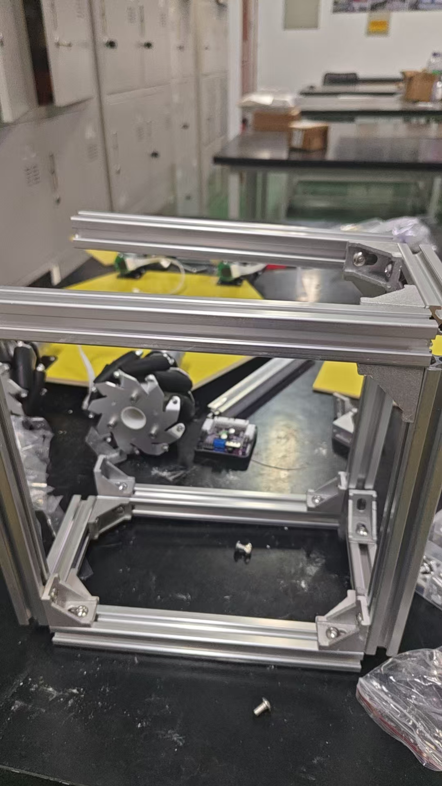

# ROS2 自动夹苗机器人

一套面向**自动取苗 → 运输 → 放苗**作业的全栈移动机器人：从机械结构、自制 PCB、STM32/FreeRTOS 固件，
到 ROS2 导航与定位，全部由本人完成。

> 起源于 **2026 睿抗机器人开发者大赛（CAIR 工程竞技赛道）**，赛后将工程整理为可复现的开源版本。



**演示视频**：[`docs/media/automatic-seedling-clamping-demo.mp4`](docs/media/automatic-seedling-clamping-demo.mp4)

---

## 1. 这套系统能做什么

| 能力 | 实现位置 | 状态 |
| --- | --- | --- |
| 麦克纳姆四轮全向移动（前后 / 横移 / 斜行 / 原地旋转） | `firmware/stm32/Robot/chassis_task.c` | 实机验证 |
| 四路编码器测速 + 增量式 PID 闭环 | `firmware/stm32/Headware/encoder.c` | 实机验证 |
| 四舵机取苗 / 夹苗 / 放苗姿态与缓动 | `firmware/stm32/Robot/arm_control.c` | 实机验证 |
| PS2 手柄遥控 + 组合键机械臂点动 | `firmware/stm32/Headware/ps2_usart5.c` | 实机验证 |
| 300 ms 失联停车、短刹、模式互锁、回中解锁 | `firmware/stm32/Robot/chassis_task.c` | 实机验证 |
| ROS2 导航（AMCL + NavFn + MPPI 全向） | `ros2_ws/` | **代码完成，待实机联调** |

---

## 2. 系统架构

```text
        ┌──────────────────────────────┐
        │  ROS2 (Ubuntu / RDK)          │
        │  chassis_node → /odom → EKF   │
        │  Nav2: AMCL + NavFn + MPPI    │
        └──────────────┬───────────────┘
                       │ UART 14B 下行 / 22B 上行
                       ▼
        ┌──────────────────────────────┐
        │  STM32F103RCT6 + FreeRTOS     │
        │  ┌────────────┬─────────────┐ │
        │  │ 底盘控制    │ 机械臂/舵机  │ │
        │  │ 逆解 + PID  │ 姿态 + 缓动  │ │
        │  └────────────┴─────────────┘ │
        │  安全：失联停车 / 模式互锁      │
        └──────────────┬───────────────┘
                       ▼
            TB6612 ×2 · 编码器 ×4 · 舵机 ×4
```

---

## 3. 实时软件（如实说明）

固件里只有 **2 个 FreeRTOS 任务**：

| 任务 | 优先级 | 栈 | 周期 | 作用 |
| --- | --- | ---: | --- | --- |
| `defaultTask` | Normal | 512 B | 1 ms | CubeMX 生成的占位空任务 |
| `chassisTask` | High | 4 KB | 20 ms | **唯一的业务主循环** |

`chassisTask` 在单个循环里串行完成：手柄帧解析 → 三级安全互锁 → 机械臂输入 → 麦轮逆解 → 编码器闭环 → 舵机输出。

**刻意不使用队列 / 信号量 / 互斥量**，中断与任务之间用 `volatile` 标志 + 单行双缓冲 + `__disable_irq` 临界区通信。
理由是控制链路本身是严格顺序的，引入跨任务 IPC 只会增加调度抖动，对 20 ms 周期没有收益。

> 真正的时间基准由 **TIM6 中断（50 Hz）** 提供，`vTaskDelayUntil` 保证任务周期无累积漂移。

---

## 4. 底盘运动学

轮序 **0=FL, 1=RR, 2=RL, 3=FR**（物理接线 remap 后的顺序，不是 FL/FR/RL/RR），
`K = L + W = 0.168 m`，轮径 `0.065 m`。

**逆解**（`chassis_task.c`）

```text
FL = vx - vy - K·wz      RR = vx - vy + K·wz
RL = vx + vy - K·wz      FR = vx + vy + K·wz
```

**正解**（`encoder.c`）

```text
vx = ( FL + RR + RL + FR) / 4
vy = (-FL - RR + RL + FR) / 4
wz = (-FL + RR - RL + FR) / (4K)
```

两个方向**严格互逆**，已验证误差 < 1e-15（见第 8 节自检工具）。

---

## 5. 执行机构

定时器资源受限，四路舵机用两种方式驱动：

- **CH1 / CH2**：硬件 PWM（PA0 / PA1）
- **CH3 / CH4**：比较中断 + GPIO 软件翻转（PC5 / PB0）

时基统一为 **TIM5 @ 1 MHz，周期 20 ms（50 Hz）**，脉宽 `500 + angle × 2000 / 180 µs`，
限幅 0–180°，缓动步进 2°/20 ms（约 100 °/s）。

---

## 6. ROS2 导航栈

`ros2_ws/` 是按本机实际参数重写的，**不是从别的项目复制**。详见
[`ros2_ws/README.md`](ros2_ws/README.md) 与 [`docs/ROS2导航设计与验证.md`](docs/ROS2导航设计与验证.md)。

| 环节 | 选型 |
| --- | --- |
| 底盘桥接 | 自研 `seedling_chassis`（C++，50 Hz） |
| 里程计 | 四轮编码器正解 → 积分 → `/odom` |
| 融合 | `robot_localization` EKF（无 IMU，仅轮速） |
| 定位 | AMCL **`OmniMotionModel`**（麦轮必须） |
| 规划 | NavFn / Dijkstra |
| 控制 | `RotationShim` + MPPI **`motion_model: Omni`** |
| 限速 | `vx 0.35 / vy 0.30 / wz 0.80` |

两个麦轮专属坑已避开：

1. AMCL 不用 `OmniMotionModel` → 横移会被当成噪声；
2. `velocity_smoother.max_velocity` 第二项留空 → 横移在输出前被截成 0。

---

## 7. 仓库结构

```text
firmware/stm32/     STM32F103RCT6 + FreeRTOS 固件（Keil MDK）
  Robot/            底盘任务、机械臂状态机、麦轮逆解
  Headware/         电机 / 编码器 / 舵机 / PS2 / I2C 驱动
  Doc/              接线说明、ROS2 接口说明
ros2_ws/            ROS2 导航栈（底盘桥接 + Nav2 参数 + URDF）
hardware/           自制控制板 KiCad 工程
mechanical/         四自由度平行夹爪与整车的 STEP / STL / DXF
docs/               媒体素材与设计文档
```

---

## 8. 快速开始

### 8.1 固件

```text
1. Keil MDK 打开 firmware/stm32/MDK-ARM/1_template_led.uvprojx
2. 确认时钟 72 MHz、TIM5 舵机时基、TIM2 PWM、编码器定时器
3. 编译并烧录 STM32F103RCT6
4. 上电前核对：电机方向、舵机零位、急停、通信波特率
```

### 8.2 ROS2

```bash
cd ros2_ws
source /opt/ros/humble/setup.bash
colcon build --symlink-install
source install/setup.bash

# 建图
ros2 launch seedling_bringup slam.launch.py

# 导航（需先有地图）
ros2 launch seedling_bringup nav2.launch.py map:=/path/to/map.yaml
```

> 接入导航前需要给固件补一组二进制串口帧，见
> [`firmware/stm32/Doc/ROS2接口说明.md`](firmware/stm32/Doc/ROS2接口说明.md)。

### 8.3 自检（无需硬件）

```bash
python3 ros2_ws/tools/kinematics_check.py    # 正解/逆解闭环、符号语义、分辨率
python3 ros2_ws/tools/protocol_selftest.py   # 14B/22B 帧编解码与校验
```

两者均为纯 Python，无第三方依赖，退出码 0 表示通过。

---

## 9. 已知限制

- **ROS2 导航尚未实机跑通**：代码完成并通过静态校验，固件侧接口未实现。
- **无 IMU**：航向完全依赖四轮正解，打滑会导致 yaw 漂移。
- **低速量化**：1320 counts/转，20 ms 采样下 1 个计数 = 7.7 mm/s，低于约 8 mm/s 时速度分辨率明显。
- **麦轮横移效率低**：`vy_max` 已收敛到 0.30 m/s，不要盲目调高。
- **无看门狗**：`stm32f1xx_hal_conf.h` 中 IWDG/WWDG 宏被注释，长期无人值守运行需自行补上。
- **无 HardFault 现场保存**：四个 fault handler 均为空 `while(1)`。

---

## 10. 路线图

- [ ] 固件实现 `ros_bridge.c`，打通 14/22 字节串口协议
- [ ] 实机验证 `/odom` 尺度与 AMCL 定位精度
- [ ] 补 IWDG 与 HardFault 寄存器快照
- [ ] 用 EKF + 轮速做里程计标定表（替代单一轮径）
- [ ] 加装 IMU（WT9011G4K）后启用 `imu0` 融合

---

## 11. 许可

本项目自研代码采用 **MIT License**，见 [LICENSE](LICENSE)。

仓库中的 `Drivers/`（ST HAL + CMSIS）与 `Middlewares/`（FreeRTOS）为第三方组件，
遵循其原始许可条款，不受本项目 MIT 许可覆盖。

---

## English Summary

A full-stack ROS2 mecanum mobile robot for automatic seedling clamping: mechanical design, custom PCB,
STM32/FreeRTOS firmware (20 ms control loop, 4-wheel incremental PID, 4-servo actuation, lost-link safety),
and a ROS2 navigation stack (encoder odometry → robot_localization EKF → AMCL `OmniMotionModel` → NavFn → MPPI `Omni`).
Kinematics and the serial protocol ship with self-checking scripts. Firmware is field-proven;
the ROS2 navigation layer is implemented and statically verified but not yet validated on hardware.
